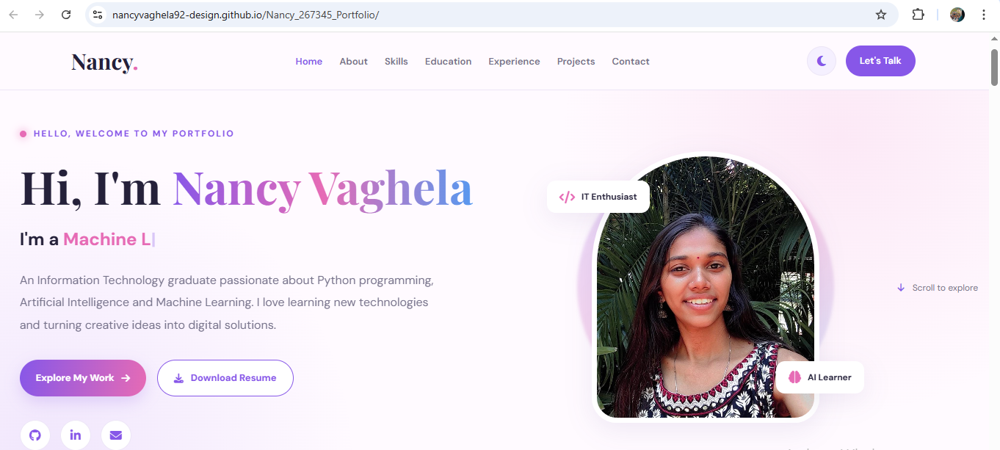

# 🌸 Nancy Vaghela – Personal Portfolio Website

**Name:** Nancy Vaghela  
**Roll Number:** 267345  
**Course:** B.Tech IT  
**Project:** Personal Portfolio Website  
**Subject:** Web Technology

---

## 📌 About the Project

This is my personal portfolio website developed as part of my Web Technology assignment.

The website introduces me, showcases my technical skills, academic projects, education and provides a contact section.

The main objective of this project is to demonstrate my understanding of HTML, CSS and JavaScript by creating a responsive and interactive personal portfolio.

## 🎯 Features

- Home section with personal introduction.
- About Me section.
- Technical Skills section.
- Education details.
- Projects showcase.
- Contact form.
- Dark and Light mode.
- Responsive navigation menu.
- Typing animation.
- Smooth scrolling and hover effects.
- Responsive design for mobile and desktop screens.

## 🛠️ Technologies Used

| Technology | Purpose |
|---|---|
| HTML5 | Website structure |
| CSS3 | Styling and responsive layout |
| JavaScript | Interactive functionality |
| Font Awesome | Icons |

## 💻 Projects Included

### 1. TripMate AI – AI-Powered Travel Assistant

A travel assistant project designed to help users explore destinations and plan their trips.

**Technologies:** Python, Streamlit, AI.

### 2. BusPulse – Design Thinking Project

A user-centered public transportation project developed using Design Thinking methodology.

It includes user interviews, research, problem identification and low, mid and high-fidelity prototypes.

**Focus:** Design Thinking, User Research and UI/UX Design.

**Presentation:** Available in the repository as a PDF.

## 📂 Project Structure

```text
Nancy_267345_Portfolio/
│
├── index.html
├── style.css
├── script.js
├── README.md
├── nancy_resume.pdf
│
├── images/
│   ├── profile.jpg
│   ├── tripmate.png
│   ├── buspulse.png
│   └── portfolio-screenshot.png
│
└── documents/
    └── buspulsedone.pdf
```

## 📸 Portfolio Screenshot



## 🌐 Live Website

[Visit My Portfolio Website](https://nancyvaghela92-design.github.io/Nancy_267345_Portfolio/)

## 🔗 GitHub Repository

[View My GitHub Repository](https://github.com/nancyvaghela92-design/Nancy_267345_Portfolio)

## 📚 Learning Outcomes

Through this project, I learned:

- How to create a website using HTML5.
- How to style webpages using CSS3.
- How to implement JavaScript functionality.
- How to create responsive web designs.
- How to manage project files using GitHub.
- How to publish a website using GitHub Pages.

---

**Developed by Nancy Vaghela**  
**Roll Number: 267345**

*Thank you for visiting my portfolio! 💜*
